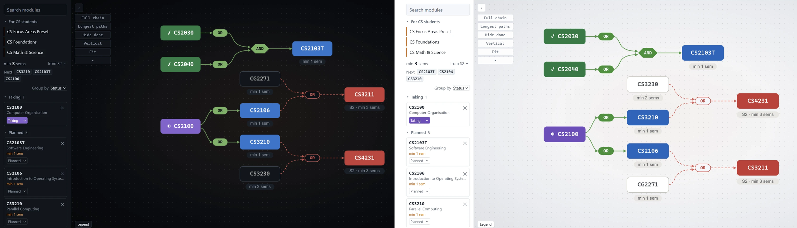

## NUS module prerequisite graph

Graphs the prerequisite chains of NUS modules for planning a degree or CS focus area. Your plan stays in your browser.

Live: https://hiroc.dev/nus-prereq-graph/

Data comes from the [NUSMods API](https://api.nusmods.com/v2/).



### Features

- Add modules by search or from the CS focus area, foundation and maths presets.
- Mark modules planned, taking or done, from the sidebar or the graph.
- See when each module runs, its minimum semesters, and what you can take next semester.
- Assign terms for MC totals and warnings about late prerequisites or semesters a module isn't offered.
- Expand the **Full chain**, highlight **Longest paths**, hide completed modules, or switch the layout direction.
- **Share graph** copies a link with your plan in it. Nothing is sent to a server.

### Limits

- Minimum semesters is a lower bound: no workload limit, this year's offerings repeating, no MA1301 needed.
- Planner warnings use this AY's offerings, and non-course conditions such as cohort rules aren't checked.

### Development

```bash
npm install
npm run dev
```

| Command | What it does |
|---|---|
| `npm test` | Runs the tests |
| `npm run lint` | Runs ESLint |
| `npm run build` | Type-checks and builds to `dist/` |
| `npm run deploy` | Builds and publishes to GitHub Pages. CI does this on every push to `main` |
| `npm run snapshot` | Rebuilds `public/data/snapshot.json` from NUSMods |

PRs go to `dev`. A release is a PR from `dev` to `main`, which deploys.

Once a semester, or when moving to a new AY: update `CURR_ACAD_YEAR` in `src/constants.ts` if needed, then run `npm run snapshot`.
